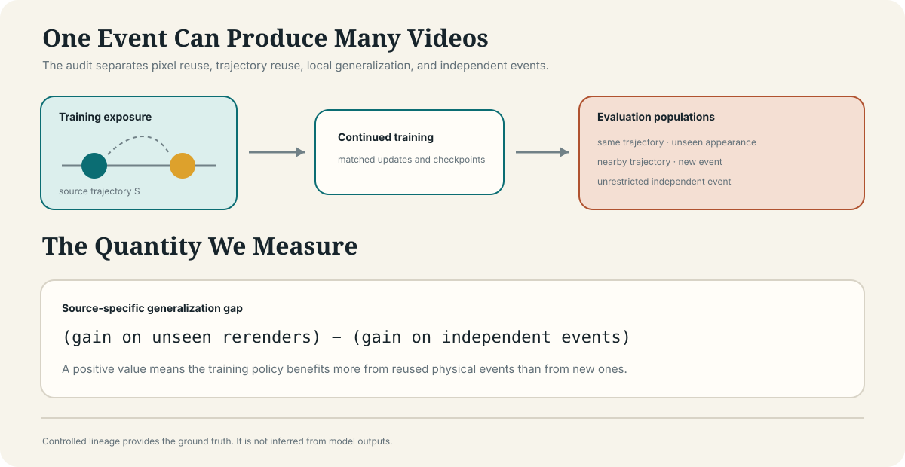
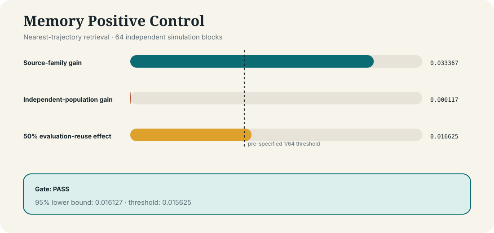
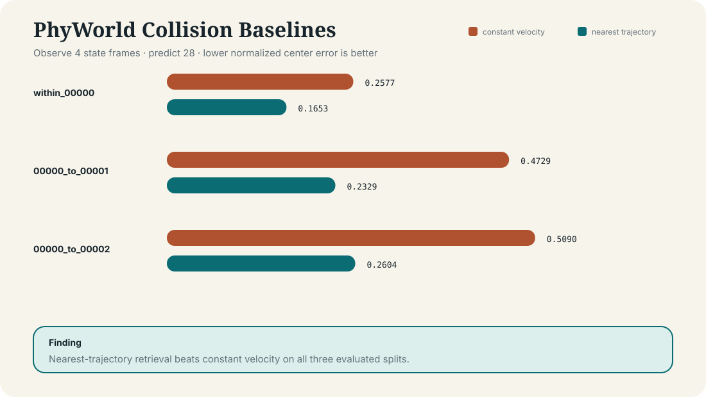

# Trajectory-lineage

[](https://github.com/physicalreasoning/trajectory-lineage/actions/workflows/tests.yml)
[](LICENSE)


**Controlled audits of trajectory-family overlap in video world-model evaluation**

[[Workstream proposal]](docs/WORKSTREAM_PROPOSAL.md)
[[Data sources]](docs/DATA.md)
[[Effect-size contract]](docs/EFFECT_SIZE.md)
[[Detector plan]](docs/DETECTORS.md)
[[Research plan]](docs/RESEARCH_PLAN.md)
[[Evaluation protocol]](docs/EVALS.md)
[[Reproduction]](docs/REPRODUCE.md)
[[Findings]](FINDINGS.md)

## Status

**Research in progress. The memory positive control passes and a 1.09M-parameter ConvLSTM predictor has been trained; the matched learned-model exposure confirmation is specified and awaiting collaborator sign-off, and no learned-model reuse effect has been estimated or released.**

The broad claim that trajectory overlap causes benchmark contamination did not survive adversarial review. This repository begins with the narrower question that remained:

> In a frozen procedural collision setting, how much does deliberate reuse of source-family trajectories change the measured advantage of one controlled training policy over another?

This is an evaluation assay, not a historical provenance detector. It cannot establish that a proprietary model trained on a particular video, website, or dataset.

<p align="center">
  
</p>

> **Figure 1.** A visually new video can still reuse a physical event encountered during training. The audit compares gains on unseen rerenders with gains on independently sampled events.

## Why this exists

Video deduplication usually asks whether two files or frames look alike. World-model evaluation can have another dependency: two videos can contain different pixels while rendering the same stored physical trajectory.

This repository makes those relationships explicit:

| relationship | meaning |
|---|---|
| `exact_render` | identical rendered tensor |
| `same_trajectory` | different render, identical stored physical states |
| `nearby_trajectory` | independently generated states linked by a declared similarity rule |
| `independent` | no derivation edge or declared neighbor relation |

Known lineage lets us run a controlled experiment. It does not tell us what an undocumented model saw during pretraining.

## What we will build

1. A deterministic collision generator with independent state and rendering layers;
2. Immutable trajectory, render, clip, split, and exposure manifests;
3. Matched continued-training branches with successful-update accounting;
4. Bounded autonomous-forecasting measurements that retain invalid outputs;
5. An evaluation-reuse assay over independent events and source-family rerenders; and
6. A findings record that preserves negative results and corrections.

## Gate 0: Recover before scaling

Before any confirmatory model run, the project must establish:

- An executable and frozen event population;
- State-preserving rerenders with distinct pixel hashes;
- A model that beats constant velocity on the easy task;
- A deliberate-exposure positive control;
- Generated-output measurement validity;
- Measured wall time, memory, storage, and failure rate; and
- A feasible preregistered inference plan.

If these fail after two documented pilot revisions, the experiment stops rather than expanding.

## Current code

This initial scaffold implements only the contracts needed before model training:

- Exact continuous-time equal-mass collisions;
- Deterministic state trajectories;
- Independent appearance rerendering;
- Lineage relationships and deterministic manifest writing;
- Bounded center-error measurement;
- The evaluation-reuse effect calculation; and
- A validated loader and manifest generator for the PhyWorld collision evaluation set.

It intentionally does **not** include a trained neural predictor or claim a world-model result.

## First local pilot

The registered nearest-trajectory memory baseline ran across 64 independent blocks:

| metric | result |
|---|---:|
| source-family gain | 0.03337 |
| independent-population gain | 0.00012 |
| 50% evaluation-reuse effect | 0.01662 |
| normal 95% lower bound | 0.01613 |
| registered threshold | 0.015625 |
| runtime | 0.48 seconds |
| gate | **pass** |

This is the expected positive control: a predictor that literally stores source trajectories is perfect on those trajectories and provides essentially no advantage on independent events. It shows that the lineage, paired-policy, metric, and result pipeline can detect deliberate memory. It does not show that a learned video world model behaves this way.

<p align="center">
  
</p>

> **Figure 2.** The pre-specified memory positive control passes across 64 independent simulation blocks.

## PhyWorld baseline

The public PhyWorld collision evaluation set is integrated as an external validation source. With the first 4 of 32 state frames observed, one-nearest-neighbor trajectory prediction outperforms constant-velocity extrapolation on the within-group split and both inspected cross-group transfers.

| Split | Constant velocity | Nearest trajectory |
|---|---:|---:|
| Within `00000` | 0.2577 | 0.1653 |
| `00000` → `00001` | 0.4729 | 0.2329 |
| `00000` → `00002` | 0.5090 | 0.2604 |

<p align="center">
  
</p>

> **Figure 3.** Nearest-trajectory retrieval is a stronger baseline than constant-velocity extrapolation on all three evaluated PhyWorld splits.

See [Data Sources](docs/DATA.md), [Findings](FINDINGS.md), and the committed machine-readable result for the full protocol and uncertainty intervals.

## ConvLSTM smoke

A compact pixel-conditioned ConvLSTM was trained for 300 updates on 512 generated collision videos and evaluated on 128 independently generated videos, across three seeds. It consumes 8 RGB frames and predicts 16 future object-centre states.

| Predictor | Mean centre error |
|---|---:|
| Persistence | 0.09886 |
| Constant velocity | 0.04882 |
| Nearest trajectory | **0.02903** |
| ConvLSTM | 0.02965 |

The ConvLSTM reduces error by 39.3% relative to constant velocity and lands within 2.1% of nearest-trajectory retrieval. The next experiment applies matched source-family, nearby-trajectory, and background continuation policies to this learned predictor.

## Duplicate-detector audit

A registered benchmark (native 224 px, 8 transformations, 14 detector variants, calibrated query-level false removal, a conventional-copy positive control, and an independent-seed replication) found that perceptual similarity tracks appearance, not trajectory:

| Detector | Re-encoded copy (5%) | Same trajectory, new appearance (1%) | Different nearby trajectory, same appearance, removed (1%) |
|---|---:|---:|---:|
| Exact hash | 0% | 0% | 0% |
| SSCD, aligned + normalized (passes copy gate) | 85% | 12% | 31% |
| Centroid tracks + mirror/time search (fails gate: JPEG corrupts extraction) | 0% | 100% | 0% |

Trajectory-aware matching recovers rerenders under appearance, texture, mirror, and time-shift changes when extraction is reliable, and calibrating only on unrestricted negatives removes most independent events that lie closer to a training trajectory than any other training clip. See `FINDINGS.md` §6 and `docs/DETECTORS.md`.

The matched learned-model exposure confirmation is specified and pending collaborator sign-off (`FINDINGS.md` §5, `docs/EFFECT_SIZE.md`).

## Setup

Python 3.11+ and [uv](https://docs.astral.sh/uv/):

```bash
uv sync
uv run pytest -q
uv run ruff check src scripts tests
uv run python scripts/smoke.py
```

Expected smoke properties:

```text
same_trajectory_hash = true
different_render_hash = true
relationship = same_trajectory
```

## Layout

```text
src/trajectory_lineage/  simulator, lineage contracts, bounded metrics
scripts/                 one executable experiment per file
results/                 committed machine-readable pilot results
experiments/             future frozen experiment configurations
tests/                   physics, lineage, and measurement invariants
docs/
  RESEARCH_PLAN.md        gates and kill criteria
  SPEC.md                 lineage and simulator contracts
  EVALS.md                metrics and claim boundaries
  REPRODUCE.md            exact commands and expected outputs
FINDINGS.md               append-only findings and corrections
```

## Non-goals

- Identifying hidden proprietary training records;
- Treating similarity as proof of membership;
- Claiming a special memorization mechanism;
- Extrapolating one small predictor to all video world models;
- Counting frames or rerenders as independent training runs; or
- Using a successful smoke test as paper evidence.

## License

Apache-2.0. Generated datasets and model checkpoints will receive explicit, separate terms before release.
